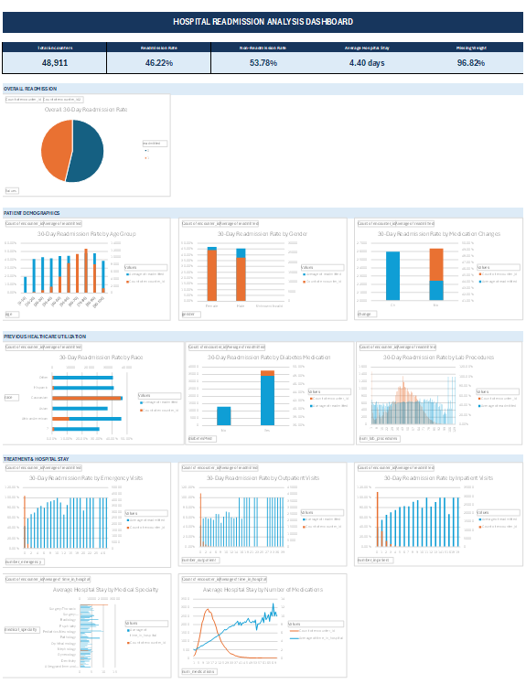

# Hospital Readmission Analysis

## Project Overview

This project analyzes hospital patient encounter data to understand patterns associated with 30-day readmissions and identify areas where hospitals may improve patient care.

The analysis focuses on patient demographics, previous healthcare utilization, medication-related factors, medical specialty, and hospital length of stay. An interactive Excel dashboard summarizes the findings to support data-driven decision-making.

## Business Problem

Hospital readmissions can indicate challenges in patient recovery and continuity of care. Understanding which patient groups and encounter characteristics are associated with higher readmission rates can help hospital administrators identify areas that may require closer attention.

The objective of this project is to explore these patterns using historical hospital encounter data and present the findings in a clear, accessible dashboard.

## Tools Used

- Microsoft Excel
- PivotTables
- PivotCharts
- Data cleaning and transformation
- Dashboard development
- Descriptive and comparative analysis

## Dataset Overview

The cleaned dataset contains **48,911 patient encounters**.

Key fields used in the analysis include:

- Patient demographics: age, gender, and race
- Hospital stay: time spent in hospital
- Previous healthcare utilization: outpatient, emergency, and inpatient visits
- Treatment information: medication count, diabetes medication, and medication changes
- Medical information: medical specialty and laboratory procedures
- Outcome: 30-day readmission status

For this analysis, `readmitted = 1` represents readmission within 30 days, while `readmitted = 0` represents no readmission within that period.

## Analysis Performed

The project includes the following analysis areas:

1. Overall 30-day readmission rate
2. Readmission rate by age group
3. Readmission rate by gender
4. Readmission rate by race
5. Readmission rate by previous emergency visits
6. Readmission rate by previous outpatient visits
7. Readmission rate by previous inpatient visits
8. Average hospital stay by medical specialty
9. Readmission rate by diabetes medication
10. Readmission rate by medication changes
11. Readmission rate by laboratory procedures
12. Average hospital stay by number of medications
13. Readmission rate by weight category

## Key Findings

- **Overall readmission rate:** 46.22% of the 48,911 encounters were readmitted within 30 days.
- **Average hospital stay:** 4.40 days.
- **Age:** Readmission rates generally increased with age, reaching 48.24% in the 70–80 age group, before declining in older groups.
- **Previous emergency visits:** Encounters with one previous emergency visit had a higher readmission rate (59.11%) than those with no previous emergency visits (43.99%).
- **Previous inpatient visits:** Encounters with one previous inpatient visit had a higher readmission rate (54.96%) than those with none (38.52%).
- **Diabetes medication:** Encounters where diabetes medication was prescribed had a readmission rate of 47.94%, compared with 40.50% where it was not prescribed.
- **Data completeness:** Weight information was missing for 96.82% of records, limiting the usefulness of weight-based analysis.

These findings show associations in the available data. They do not establish that any individual factor directly causes readmission.

## Dashboard

The Excel dashboard presents the key performance indicators and 13 visualizations covering readmission patterns, patient demographics, healthcare utilization, and treatment-related factors.

## Recommendations

Based on the observed patterns:

- Pay closer attention to patients with a history of previous inpatient or emergency visits.
- Review discharge planning and follow-up practices for patient groups with higher observed readmission rates.
- Examine care requirements for older patient groups.
- Improve the completeness of patient records, particularly weight information.
- Investigate the factors associated with longer hospital stays and higher readmission rates in further analysis.

These are areas for further investigation, not proven interventions from this analysis.

## Limitations

- The analysis is based on historical encounter-level data.
- Readmission rates are calculated per encounter, not necessarily per unique patient.
- Missing values, particularly in weight and medical specialty, limit some comparisons.
- The analysis is descriptive and does not establish causation.
- Financial impact, patient satisfaction, and predictive modelling were not established by this analysis.

## Project Files

- `Hospital_Readmission_Analysis.xlsx` — Excel workbook containing the cleaned data, PivotTables, PivotCharts, and dashboard.

## Conclusion

This project demonstrates how Excel-based data cleaning, PivotTables, PivotCharts, and dashboard development can be used to investigate hospital readmission patterns and communicate findings in a business-oriented format.
